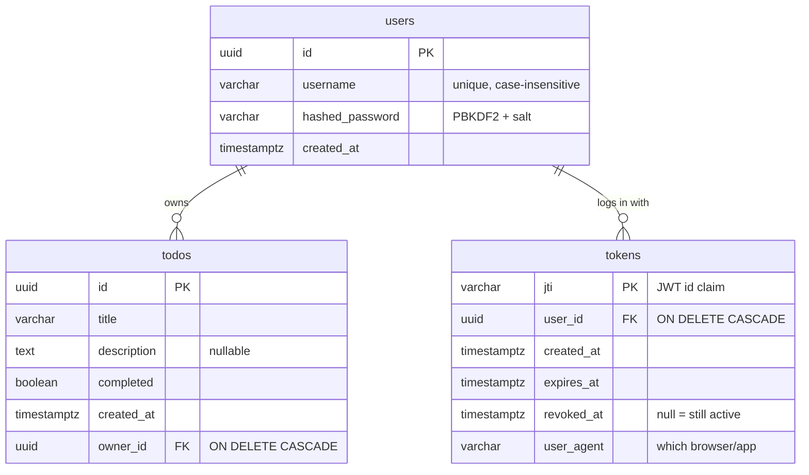
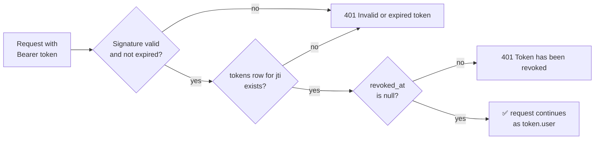
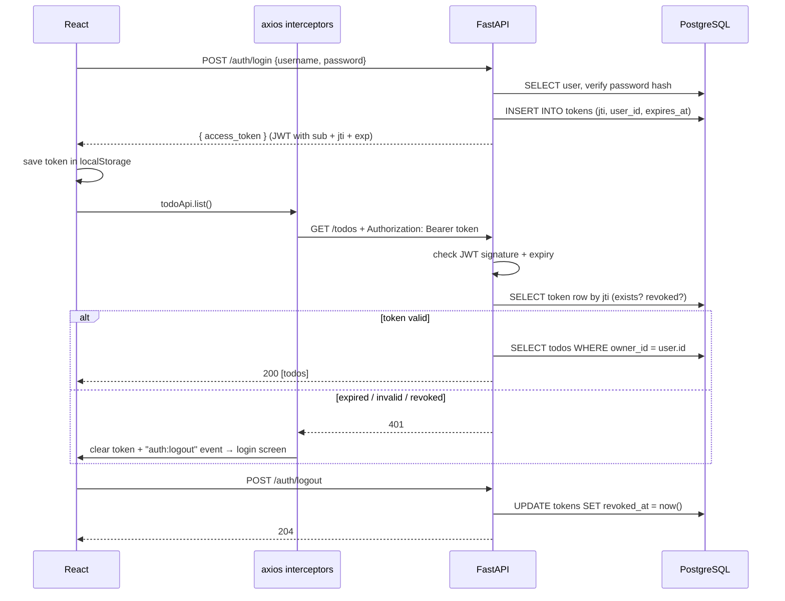

# Todo App — FastAPI + React 19 + PostgreSQL

A small full-stack app for learning the basic workflow:

- **Backend:** FastAPI + Pydantic, SQLAlchemy 2.0 + PostgreSQL, JWT auth with tokens stored in the DB (so logout really revokes them), CORS, custom middleware
- **Frontend:** React 19 (Vite) + axios with request/response interceptors
- **Infra:** Docker Compose runs Postgres, pgAdmin, the backend and the frontend, with live reload while you code

```text
fast-api/
├── .env.example             # template for .env (all settings, NO passwords)
├── docker-compose.yml       # development: db + pgadmin + backend + frontend, live reload
├── docker-compose.prod.yml  # production-like overrides (nginx build, no reload)
├── docs/docker.md           # full Docker guide
├── postman/                 # API test collection + environment
├── backend/
│   ├── app/
│   │   ├── main.py          # app setup: lifespan (create tables), middleware, CORS, routers
│   │   ├── config.py        # settings from env variables (no default secrets)
│   │   ├── database.py      # SQLAlchemy engine, session, get_db dependency
│   │   ├── models.py        # SQLAlchemy models = DB tables (users, todos, tokens)
│   │   ├── schemas.py       # Pydantic models = API request/response shapes
│   │   ├── security.py      # password hashing, JWT, get_current_user dependency
│   │   ├── middleware.py    # RequestID + Timing/Logging middleware
│   │   └── routers/
│   │       ├── auth.py      # /api/auth/register, /login, /logout, /me, /sessions
│   │       └── todos.py     # /api/todos CRUD (protected)
│   ├── pyproject.toml       # uv project: dependencies + metadata
│   ├── uv.lock              # exact pinned versions
│   └── Dockerfile
└── frontend/
    ├── Dockerfile           # targets: dev (Vite) and prod (nginx)
    ├── nginx.conf
    └── src/
        ├── api/axiosClient.js      # axios instance + interceptors (JWT)
        ├── api/services.js         # authApi / todoApi functions
        ├── context/AuthContext.jsx # global login state
        ├── components/AuthForm.jsx
        ├── components/TodoList.jsx
        └── App.jsx
```

## Quick start (Docker)

You need Docker Desktop running. **Full guide: [docs/docker.md](docs/docker.md)**, covering setup, every env variable, start, stop, restart, live reload and troubleshooting.

```powershell
Copy-Item .env.example .env          # 1. create your env file
#                                      2. fill in POSTGRES_PASSWORD, SECRET_KEY, PGADMIN_PASSWORD
#                                         generate each with: python -c "import secrets; print(secrets.token_hex(32))"
docker compose up --build --watch    # 3. start everything with live reload
```

| Open | What |
|---|---|
| <http://localhost:5173> | The app |
| <http://localhost:8000/docs> | Interactive API docs |
| <http://localhost:5050> | pgAdmin. Log in with `PGADMIN_EMAIL` / `PGADMIN_PASSWORD` from `.env` |

**While it runs, just edit code.** Saved `.py` files reload the backend in about a second. React changes appear in the browser instantly. Installing a package rebuilds the container automatically. There are no manual restarts.

Stop with **Ctrl+C**, or `docker compose down`. Your data is kept in a Docker volume.

## Environment variables and secrets

- **One file, `.env` in the project root,** configures everything: Docker Compose, the backend, the frontend and pgAdmin. It's git-ignored.
- **`.env.example`** is the committed template. It holds variable names and harmless defaults, and leaves every password empty.
- **No password exists in any committed file.** Compose stops with a clear error if a required value is missing (`${VAR:?...}`). The backend has no fallback secrets either. pgAdmin's connection settings and password file are generated inside the container at startup from `.env`.
- **Only `VITE_*` variables reach the browser,** so never put secrets in them.

The full table of variables and how to change them safely is in [docs/docker.md](docs/docker.md#3-set-up-environment-variables).

## Run without Docker for the app code (optional)

You can run only Postgres in Docker and the backend and frontend directly on your machine. They read the same root `.env`.

```powershell
docker compose up -d db pgadmin           # database + UI

cd backend
uv sync                                   # first time: creates .venv
uv run fastapi dev app/main.py            # http://localhost:8000

cd ../frontend
npm install                               # first time
npm run dev                               # http://localhost:5173
```

The backend uses [uv](https://docs.astral.sh/uv/). `uv add <pkg>` installs a package and records it in `pyproject.toml` + `uv.lock`, and `uv run <cmd>` runs inside the project's `.venv` without activating it.

## Database (PostgreSQL)

### Tables



Two kinds of model, which is easy to mix up at first:

| | SQLAlchemy model ([models.py](backend/app/models.py)) | Pydantic schema ([schemas.py](backend/app/schemas.py)) |
|---|---|---|
| Describes | A **table** in Postgres | What the **API** accepts and returns |
| Example | `User` has `hashed_password` | `UserOut` has no `hashed_password` |
| Link | — | `from_attributes=True` lets a schema read a model object |

### Why tokens are stored in the DB

A JWT is self-contained: the server checks its signature and expiry without any lookup. That's fast, but it means a token **can't be cancelled**. It stays valid until it expires, even after the user "logs out".

Storing one row per login in `tokens` fixes that:



- **Login** creates a row with a random `jti` and puts that `jti` inside the JWT.
- **Every request** checks the signature (no DB needed), then looks up the row.
- **Logout** sets `revoked_at`, and from then on that token gets 401.
- **`GET /api/auth/sessions`** lists your active logins, one row per device or browser.
- **Expired rows** for a user are deleted each time that user logs in.

Only the `jti` is stored, never the token string itself. If the table leaked, the rows couldn't be used to log in, the same reason passwords are stored as hashes.

### Browse the data with pgAdmin

Open <http://localhost:5050> and log in with `PGADMIN_EMAIL` / `PGADMIN_PASSWORD` from your `.env`. Then:

1. Expand **Servers → Todo DB (docker) → Databases → todo → Schemas → public → Tables**. It connects without asking for the database password.
2. Right-click a table → **View/Edit Data → All Rows** to see its rows. Try `tokens` before and after logging out in the app.
3. **Tools → Query Tool** opens a SQL editor.
4. Right-click the database → **ERD For Database** draws the table relationships.

Other tools (DBeaver, DataGrip, TablePlus, the VS Code PostgreSQL extension) can connect to `localhost:5432` with the user, password and database from your `.env`.

Tables are created by `Base.metadata.create_all()` at startup. It only creates **missing** tables and never alters existing ones. After changing a model, reset the data with `docker compose down -v` (⚠️ deletes data), or use **Alembic** migrations in a real project.

## Test the API with Postman

The [postman/](postman/) folder has a collection that tests the whole flow in order:

| Folder | What it checks |
|---|---|
| 0. Health | API is up |
| 1. Auth | Register (201), duplicate (409), invalid data (422), wrong password (401), login (saves the token and decodes the JWT, including `jti`), `/me`, `/sessions` |
| 2. Todos | Create, list, get, PATCH, both filters, delete, then 404 after delete |
| 3. Security | No token, garbage token and a **tampered** token all get 401. A second user can't see or delete the first user's todos |
| 4. CORS | Preflight from `localhost:5173` is allowed, one from another origin is rejected, and `expose_headers` is present |
| 5. Logout | Logout (204), then the same token gets 401 "revoked", while the other user's token still works |

Every response is also checked for the `X-Request-ID` and `X-Process-Time` middleware headers. Each run registers new users with **random** passwords, so the collection contains no passwords and can be re-run any number of times.

**In Postman:** import both files from `postman/`, select the **Todo API - Local** environment, start the app, then **Run collection**. Run it as a whole, because each request saves values (token, IDs) that later ones use.

**From the terminal:**

```powershell
npx newman run postman/Todo-API.postman_collection.json -e postman/Todo-API-local.postman_environment.json
```

## How login + JWT works



## How a request flows

Example: clicking **Add** on a todo.

```text
React (TodoList.jsx)
  └─ todoApi.create("Buy milk")                         services.js
      └─ api.post("/todos", {...})                      axiosClient.js
          └─ REQUEST INTERCEPTOR adds  Authorization: Bearer <jwt>
              │
              │  Browser: different origin (5173 -> 8000)?
              │  -> sends OPTIONS preflight first (CORS)
              ▼
FastAPI
  CORSMiddleware            answers preflight, adds Access-Control-* headers
  RequestIDMiddleware       request.state.request_id = "a1b2c3d4"
  TimingLoggingMiddleware   starts a timer
  @app.middleware("http")   adds X-Powered-By
  Router: POST /api/todos
    ├─ Pydantic validates body (TodoCreate)        -> 422 if invalid
    ├─ Depends(get_db) opens a DB session
    ├─ Depends(get_current_user) checks JWT + tokens table -> 401 if bad/revoked
    └─ db.add(Todo(...)); db.commit()              -> INSERT INTO todos ...
  response_model=TodoOut shapes the JSON
  session closed (end of get_db)
              │
              ▼  (middleware runs again in reverse, adding headers)
axios RESPONSE INTERCEPTOR
  ├─ success: logs timing + X-Request-ID to the console
  └─ error:   401 -> clear token + fire "auth:logout" event
              any -> turn FastAPI's `detail` into error.message
React updates state -> UI re-renders
```

## Concepts to explore

| Concept | Where | Try this |
|---|---|---|
| Pydantic validation | `schemas.py` | Register with a 2-char username and look at the 422 |
| response_model filtering | `routers/auth.py` | `hashed_password` is in the `users` table but never in responses |
| Dependency injection | `security.py` → `get_current_user` | Call `/api/todos` in /docs without "Authorize" |
| DB session per request | `database.py` → `get_db` | Set `SQL_ECHO=true` in `.env`, run `docker compose up -d`, watch the SQL in `docker compose logs -f backend` |
| ORM queries | `routers/todos.py` | Compare the `select(...)` code with the SQL printed by `SQL_ECHO` |
| JWT | `security.py` | Paste a token into jwt.io to see `sub`, `jti` and `exp` |
| Token revocation | `security.py` + `tokens` table | Copy your token, log out, then call `/api/auth/me` with it in /docs |
| Sessions | `/api/auth/sessions` | Log in from two browsers and list both sessions |
| Middleware order | `main.py` | Check the `X-Request-ID` / `X-Process-Time` headers in DevTools |
| CORS | `main.py` | Remove `5173` from `ALLOWED_ORIGINS`; the browser blocks the call |
| CORS expose_headers | `main.py` + `axiosClient.js` | Remove `expose_headers`; the console log shows `undefined` |
| Request interceptor | `axiosClient.js` | Token is attached automatically to every call |
| Response interceptor | `axiosClient.js` | Edit the token in localStorage, refresh, and you are logged out |
| Live reload | `docker-compose.yml` → `develop.watch` | Change a message in `routers/todos.py` and call the endpoint again |

## API

| Method | Path | Auth | Body |
|---|---|---|---|
| POST | `/api/auth/register` | — | `{username, password}` |
| POST | `/api/auth/login` | — | `{username, password}` → `{access_token}` |
| POST | `/api/auth/logout` | ✅ | — (revokes the current token) |
| GET | `/api/auth/me` | ✅ | — |
| GET | `/api/auth/sessions` | ✅ | — (active logins from the `tokens` table) |
| GET | `/api/todos?completed=true` | ✅ | — |
| POST | `/api/todos` | ✅ | `{title, description?}` |
| GET | `/api/todos/{id}` | ✅ | — |
| PATCH | `/api/todos/{id}` | ✅ | `{title?, description?, completed?}` |
| DELETE | `/api/todos/{id}` | ✅ | — |
