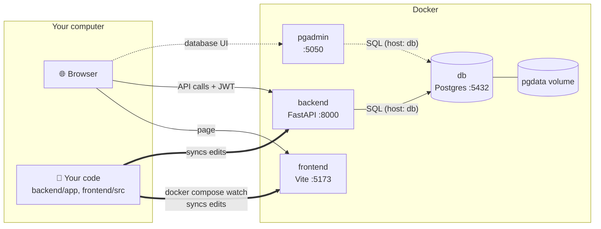
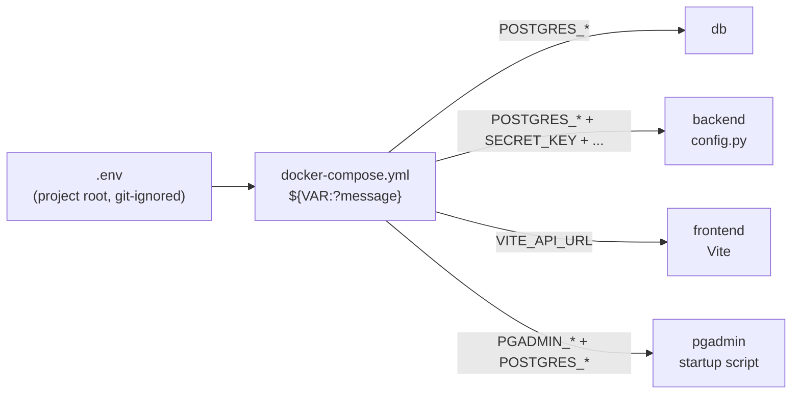
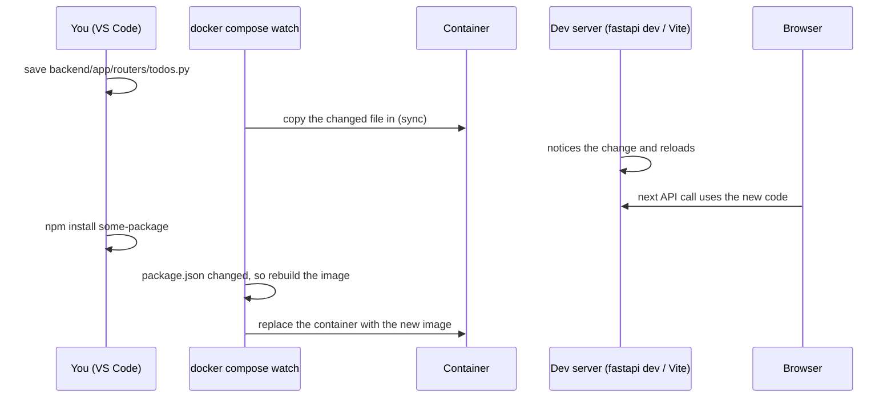

# Running the app with Docker

This guide covers everything you need to run the Todo app in Docker:

1. [What runs where](#1-what-runs-where)
2. [Prerequisites](#2-prerequisites)
3. [Set up environment variables](#3-set-up-environment-variables)
4. [Start the application](#4-start-the-application)
5. [Develop with live reload](#5-develop-with-live-reload-no-manual-restarts)
6. [Stop the application](#6-stop-the-application)
7. [Restart and rebuild](#7-restart-and-rebuild)
8. [Check that everything works](#8-check-that-everything-works)
9. [Production-like mode](#9-production-like-mode)
10. [Troubleshooting](#10-troubleshooting)
11. [Command cheat sheet](#11-command-cheat-sheet)

---

## 1. What runs where

`docker-compose.yml` defines four services:

| Service | Container | URL on your machine | What it is |
|---|---|---|---|
| `frontend` | `todo-frontend` | <http://localhost:5173> | React app on the Vite dev server (hot reload) |
| `backend` | `todo-backend` | <http://localhost:8000> (docs: <http://localhost:8000/docs>) | FastAPI with `fastapi dev` (auto-reload) |
| `db` | `todo-db` | `localhost:5432` | PostgreSQL 18 |
| `pgadmin` | `todo-pgadmin` | <http://localhost:5050> | pgAdmin 4, a web UI for the database |



Inside Docker's network, containers reach each other by **service name**, so the backend connects to the database at host `db`. Your browser runs on your machine, so it uses `localhost`.

**Startup order** is enforced with health checks:

1. `db` starts first, and is ready when `pg_isready` succeeds.
2. `backend` and `pgadmin` start once `db` is ready. `backend` is ready when `/api/health` answers.
3. `frontend` starts once `backend` is ready.

---

## 2. Prerequisites

- **Docker Desktop** (Windows/macOS) or Docker Engine (Linux), with **Docker Compose v2.24 or newer**. `docker compose watch` and the `!override` tag used by the production file need it. Check with:

  ```powershell
  docker compose version
  ```

- Docker Desktop must be **running**. If you see `failed to connect to the docker API`, start it and wait until the whale icon says "running".
- Free ports: **5173, 8000, 5432, 5050**.

---

## 3. Set up environment variables

All configuration lives in **one file: `.env` in the project root**. It is git-ignored, so your passwords never get committed. The committed template is `.env.example`, which holds variable names and harmless defaults only, with **no passwords**.

### 3.1 Create `.env`

```powershell
cd D:\path\to\fast-api
Copy-Item .env.example .env
```

### 3.2 Fill in the empty values

Open `.env` and fill in the three empty values. To generate strong random values:

```powershell
# Run once per value and paste the output into .env
python -c "import secrets; print(secrets.token_hex(32))"
```

If Python isn't installed, use `docker run --rm python:3.14-slim python -c "import secrets; print(secrets.token_hex(32))"`.

| Variable | Required | Example / default | Used by | Notes |
|---|---|---|---|---|
| `POSTGRES_USER` | ✅ | `todo` | db, backend, pgadmin | Database user |
| `POSTGRES_DB` | ✅ | `todo` | db, backend, pgadmin | Database name |
| `POSTGRES_PASSWORD` | ✅ | *(generate)* | db, backend, pgadmin | Use letters and digits only (`token_hex`), because `:` or `\` break pgAdmin's password file |
| `SECRET_KEY` | ✅ | *(generate)* | backend | Signs JWTs. Changing it logs everyone out |
| `ACCESS_TOKEN_EXPIRE_MINUTES` | | `30` | backend | Login lifetime |
| `ALLOWED_ORIGINS` | | `http://localhost:5173,http://127.0.0.1:5173` | backend | CORS allow-list, comma-separated |
| `SQL_ECHO` | | `false` | backend | `true` prints every SQL query in the backend logs |
| `VITE_API_URL` | | `http://localhost:8000/api` | frontend | Where the browser sends API calls. **Public**: never put secrets in `VITE_*` |
| `PGADMIN_EMAIL` | ✅ | `admin@example.com` | pgadmin | pgAdmin login (must look like an email) |
| `PGADMIN_PASSWORD` | ✅ | *(generate)* | pgadmin | pgAdmin login password |

### 3.3 How the values reach each service



- Docker Compose reads `.env` automatically and substitutes `${VAR}` in `docker-compose.yml`.
- **Required values use `${VAR:?message}`.** If one is missing, Compose stops before starting anything:

  ```text
  required variable POSTGRES_PASSWORD is missing a value: Set POSTGRES_PASSWORD in .env
  ```

- The backend's [config.py](../backend/app/config.py) has **no default passwords or keys**. It also refuses to start if one is missing.
- pgAdmin's server list and password file are **generated at container start** from these variables, so no file with a password exists in the repo.
- Running outside Docker (`uv run`, `npm run dev`) reads the **same** `.env`.

### 3.4 Check your `.env` without starting anything

```powershell
docker compose config --quiet
```

No output means every required value is set.

### 3.5 Changing a value later

| You changed | Do this |
|---|---|
| `SECRET_KEY`, `ALLOWED_ORIGINS`, `SQL_ECHO`, `ACCESS_TOKEN_EXPIRE_MINUTES` | `docker compose up -d` (recreates only the affected containers) |
| `VITE_API_URL` | `docker compose up -d frontend` |
| `PGADMIN_EMAIL` / `PGADMIN_PASSWORD` | Only applied when pgAdmin's data is first created. Reset pgAdmin (see [Troubleshooting](#10-troubleshooting)) |
| `POSTGRES_PASSWORD` | See below. Postgres only reads it when the database is **first created** |

**Changing `POSTGRES_PASSWORD` while keeping your data:**

```powershell
# 1. Set the new password inside Postgres (runs with the OLD .env still in place)
docker compose exec db psql -U todo -d todo -c "ALTER USER todo WITH PASSWORD 'the-new-password';"
# 2. Put the same value in .env as POSTGRES_PASSWORD
# 3. Recreate the services that use it
docker compose up -d
docker compose rm -sf pgadmin; docker volume rm fast-api_pgadmin-data; docker compose up -d pgadmin
```

---

## 4. Start the application

From the project root:

```powershell
docker compose up --build --watch
```

| Part | Meaning |
|---|---|
| `up` | Create and start all services |
| `--build` | Build the images first (needed the first time and after Dockerfile changes) |
| `--watch` | Sync code changes into the running containers (see [section 5](#5-develop-with-live-reload-no-manual-restarts)) |

The first build takes a few minutes; later starts take seconds. When you see the services' logs, open:

- App: <http://localhost:5173>
- API docs: <http://localhost:8000/docs>
- pgAdmin: <http://localhost:5050>. Log in with `PGADMIN_EMAIL` / `PGADMIN_PASSWORD`, then open **Servers → Todo DB (docker)**. It connects without asking for the database password.

**Run in the background instead.** This frees the terminal, but there's no live sync unless you add `watch`:

```powershell
docker compose up --build -d     # start in the background
docker compose watch             # optional: sync changes (Ctrl+C stops syncing only)
docker compose logs -f           # optional: follow the logs
```

---

## 5. Develop with live reload (no manual restarts)

With `--watch` (or `docker compose watch`), you **edit files normally in VS Code** and the running containers update by themselves:

| You edit | What happens | How fast |
|---|---|---|
| `backend/app/**/*.py` | File is synced into the container, and `fastapi dev` restarts the server | ~1–2 s |
| `frontend/src/**` (`.jsx`, `.css`, ...) | File is synced, and Vite **hot module reload** updates the browser without a page refresh | instant |
| `frontend/index.html`, `vite.config.js` | Synced; Vite reloads the page or restarts itself | ~1–2 s |
| `backend/pyproject.toml` / `uv.lock` (`uv add <pkg>`) | Image is **rebuilt** and the container recreated automatically | ~10–60 s |
| `frontend/package.json` / `package-lock.json` (`npm install <pkg>`) | Image is **rebuilt** and the container recreated automatically | ~10–60 s |



The rules live in the `develop.watch` section of each service in [docker-compose.yml](../docker-compose.yml):

- `action: sync` copies changed files into the container.
- `action: rebuild` rebuilds the image and recreates the container, used for dependency files.

**Why watch instead of bind-mounting the code folder?** On Windows, file-change events from a mounted folder often don't reach Linux containers, so auto-reload silently stops working. `watch` copies the files in, so the dev servers always see the change.

**Adding a dependency** (with watch running):

```powershell
cd backend;  uv add httpx          # backend: rebuild happens automatically
cd frontend; npm install dayjs     # frontend: rebuild happens automatically
```

**Changes that are NOT picked up automatically:**

| Change | Do this |
|---|---|
| `Dockerfile` | `docker compose up -d --build <service>` |
| `docker-compose.yml` | `docker compose up -d` |
| `.env` | `docker compose up -d` (see [3.5](#35-changing-a-value-later)) |
| SQLAlchemy model columns (`models.py`) | Code reloads, but **existing tables are not altered**: `create_all` only creates missing tables. Reset the data with `docker compose down -v` (or add Alembic migrations) |

---

## 6. Stop the application

| Command | Containers | Data (database, pgAdmin settings) |
|---|---|---|
| **Ctrl+C** in the `up --watch` terminal | Stopped | Kept |
| `docker compose stop` | Stopped (not removed) | Kept |
| `docker compose down` | Stopped **and removed** | **Kept** |
| `docker compose down -v` | Stopped and removed | ⚠️ **Deleted**: removes the `pgdata` and `pgadmin-data` volumes, so the database is empty next time |

Use `docker compose down` day to day. Use `down -v` only when you want a fresh, empty database.

---

## 7. Restart and rebuild

| Situation | Command |
|---|---|
| Start again after `stop` / `down` | `docker compose up -d` (add `--watch` and drop `-d` for live sync) |
| Restart one service (for example after it crashed) | `docker compose restart backend` |
| Restart everything | `docker compose restart` |
| Rebuild one image after editing its `Dockerfile` | `docker compose up -d --build backend` |
| Rebuild everything from scratch (ignore build cache) | `docker compose build --no-cache; docker compose up -d` |
| Apply `.env` or `docker-compose.yml` changes | `docker compose up -d` |

With `--watch` running, **code changes need none of these**: see [section 5](#5-develop-with-live-reload-no-manual-restarts).

---

## 8. Check that everything works

### 8.1 Service status

```powershell
docker compose ps
```

All four should show **`(healthy)`**:

```text
NAME            STATUS
todo-backend    Up 2 minutes (healthy)
todo-db         Up 2 minutes (healthy)
todo-frontend   Up 2 minutes (healthy)
todo-pgadmin    Up 2 minutes (healthy)
```

`(health: starting)` is normal for up to about 30 seconds after starting. `(unhealthy)` means: check the logs.

### 8.2 Per-service checks

| Service | Check | Expected |
|---|---|---|
| backend | `curl http://localhost:8000/api/health` | `{"status":"ok"}` |
| backend → db | `docker compose logs backend \| Select-String "Database ready"` | a `Database ready` line |
| db | `docker compose exec db pg_isready` | `accepting connections` |
| frontend | Open <http://localhost:5173> | Login page |
| pgadmin | Open <http://localhost:5050>, log in, expand **Todo DB (docker)** | Connects without a password prompt |

### 8.3 Full API test

With the stack running, from the project root:

```powershell
npx newman run postman/Todo-API.postman_collection.json -e postman/Todo-API-local.postman_environment.json
```

This runs 34 requests (auth, CRUD, security, CORS, logout) with 171 checks. They should all pass.

### 8.4 Logs

```powershell
docker compose logs -f              # all services
docker compose logs -f backend      # one service (request timing lines appear here)
docker compose logs --tail 50 db    # last 50 lines
```

### 8.5 Look inside the database

```powershell
docker compose exec db psql -U todo -d todo     # use your POSTGRES_USER / POSTGRES_DB
```

```sql
\dt
SELECT username, created_at FROM users;
SELECT jti, revoked_at, user_agent FROM tokens;
\q
```

---

## 9. Production-like mode

`docker-compose.prod.yml` layers on top of the dev file:

- **Backend:** runs `fastapi run`, without reload.
- **Frontend:** a static build served by **nginx**, with no Node.
- **No watch.**

```powershell
docker compose -f docker-compose.yml -f docker-compose.prod.yml up --build -d
```

It uses the same URLs. Go back to dev mode with `docker compose up --build -d` (or `--watch`).

`VITE_API_URL` is **baked into the JavaScript at build time** in this mode. Rebuild the frontend after changing it.

---

## 10. Troubleshooting

| Symptom | Cause / fix |
|---|---|
| `required variable X is missing a value` | `.env` is missing or `X` is empty. See [section 3](#3-set-up-environment-variables) |
| `failed to connect to the docker API` | Docker Desktop isn't running |
| `Bind for 0.0.0.0:5432 failed: port is already allocated` | Something else uses the port, often a Postgres installed on Windows or another project. Stop it, or change the left side of `ports:` (for example `"5433:5432"`) |
| Backend logs: `password authentication failed for user` | `POSTGRES_PASSWORD` in `.env` doesn't match the existing database. Postgres only reads it on first creation. Use the `ALTER USER` steps in [3.5](#35-changing-a-value-later), or start fresh with `docker compose down -v` (**deletes data**) |
| pgAdmin asks for the database password | pgAdmin's saved settings are from an older config. Reset pgAdmin (below) |
| Can't log in to pgAdmin with the `.env` credentials | They're stored when pgAdmin's data is first created. After 3 wrong tries the account is locked. Reset pgAdmin (below) |
| Code changes don't show up | Make sure `watch` is running (`docker compose up --watch` or `docker compose watch`). Check its terminal for sync messages |
| Frontend shows "Cannot reach server" | Backend not healthy yet. Check `docker compose ps` and `docker compose logs backend` |
| Browser console shows a CORS error | Your frontend URL isn't in `ALLOWED_ORIGINS`. Edit `.env`, then `docker compose up -d` |

**Reset pgAdmin** (removes only pgAdmin's settings, not your database):

```powershell
docker compose rm -sf pgadmin
docker volume rm fast-api_pgadmin-data
docker compose up -d pgadmin
```

**Start completely fresh** (⚠️ deletes all database data):

```powershell
docker compose down -v
docker compose up --build --watch
```

---

## 11. Command cheat sheet

```powershell
# First time
Copy-Item .env.example .env              # then fill in the empty values
docker compose config --quiet            # check .env (no output = OK)

# Daily development
docker compose up --build --watch        # start + live reload   (Ctrl+C to stop)
docker compose down                      # stop and remove containers (data kept)

# Status and logs
docker compose ps                        # all should be (healthy)
docker compose logs -f backend           # follow one service's logs

# Restarting
docker compose restart backend           # restart one service
docker compose up -d --build backend     # rebuild one service (after Dockerfile edits)
docker compose up -d                     # apply .env / compose file changes

# Database
docker compose exec db psql -U todo -d todo
docker compose down -v                   # ⚠️ wipe the database and start fresh

# Production-like
docker compose -f docker-compose.yml -f docker-compose.prod.yml up --build -d
```
