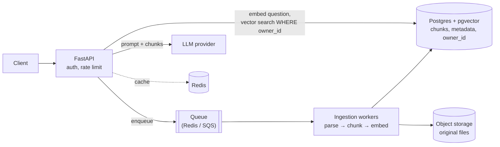

# Python & FastAPI interview questions for AI engineers

Questions you can expect for **AI engineer / ML engineer / backend-for-AI** roles, with short answers you can say out loud in an interview. Where this project already shows a concept, the answer links to the file, so you can point to working code you built.

**How to use this:** read the question, answer it yourself first (out loud, under 2 minutes), then open the answer.

**Contents:**

1. [Most-asked questions (start here)](#1-most-asked-questions-start-here)
2. [Python core](#2-python-core)
3. [Python concurrency & performance](#3-python-concurrency--performance)
4. [Modern Python (3.10 → 3.14)](#4-modern-python-310--314)
5. [Pydantic](#5-pydantic)
6. [FastAPI fundamentals](#6-fastapi-fundamentals)
7. [Auth & security](#7-auth--security)
8. [Databases & SQLAlchemy](#8-databases--sqlalchemy)
9. [Testing](#9-testing)
10. [Deployment & production](#10-deployment--production)
11. [AI engineering with FastAPI](#11-ai-engineering-with-fastapi)
12. [System design](#12-system-design)
13. [Live coding exercises](#13-live-coding-exercises)
14. [Talking about this project](#14-talking-about-this-project)
15. [Questions to ask them](#15-questions-to-ask-them)

---

## 1. Most-asked questions (start here)

If you only have an hour, be ready for these:

| # | Question | Section |
|---|---|---|
| 1 | `async def` vs `def` endpoints in FastAPI: what runs where? | [6.3](#63-async-def-vs-def-endpoints) |
| 2 | What is the GIL, and when do you use threads vs processes vs asyncio? | [3.1](#31-what-is-the-gil) |
| 3 | How does FastAPI's dependency injection work? | [6.4](#64-how-does-dependency-injection-work) |
| 4 | How would you stream an LLM response to the client? | [11.1](#111-stream-an-llm-response) |
| 5 | How do you get reliable structured output (JSON) from an LLM? | [11.3](#113-structured-output-from-an-llm) |
| 6 | Design a RAG API. | [12.1](#121-design-a-rag-question-answering-api) |
| 7 | JWT auth: how does it work, and how do you log a user out? | [7.1](#71-how-does-jwt-auth-work)–[7.2](#72-how-do-you-revoke-a-jwt) |
| 8 | Where do you load an ML model in a FastAPI app? | [11.4](#114-where-do-you-load-a-model) |
| 9 | Decorators and generators: explain and write one. | [2.4](#24-what-is-a-decorator), [2.5](#25-generators-and-yield) |
| 10 | How do you handle rate limits and failures when calling LLM APIs? | [11.2](#112-calling-llm-apis-reliably) |

---

## 2. Python core

### 2.1 Mutable vs immutable types

<details><summary>Answer</summary>

- **Immutable:** `int`, `float`, `str`, `tuple`, `frozenset`, `bytes`. "Changing" one creates a new object.
- **Mutable:** `list`, `dict`, `set`, most custom objects. They change in place.

It matters because variables are **references**: two names can point at the same list, so changing it through one is visible through the other. Only hashable (normally immutable) objects can be dict keys or set members.

</details>

### 2.2 The mutable default argument trap

```python
def add(item, items=[]):
    items.append(item)
    return items

add(1); add(2)   # -> [1, 2]   why?
```

<details><summary>Answer</summary>

Default values are evaluated **once**, when the function is defined, not on each call, so every call shares the same list. Fix:

```python
def add(item, items=None):
    if items is None:
        items = []
    items.append(item)
    return items
```

Same idea in Pydantic/dataclasses: use `Field(default_factory=list)` / `field(default_factory=list)`.

</details>

### 2.3 `is` vs `==`

<details><summary>Answer</summary>

`==` compares **values** (calls `__eq__`). `is` compares **identity** (same object in memory). Use `is` only for singletons: `x is None`, `x is True`. `a is b` can be `True` for small ints or short strings because of CPython caching, but that's an implementation detail you must not rely on.

</details>

### 2.4 What is a decorator?

<details><summary>Answer</summary>

A function that takes a function and returns a new function (usually a wrapper), applied with `@`. It's used for cross-cutting concerns: logging, timing, retries, caching, auth. FastAPI's `@app.get(...)` is a decorator that **registers** the function as a route.

```python
import functools, time

def timed(fn):
    @functools.wraps(fn)          # keep the name, docstring and signature
    def wrapper(*args, **kwargs):
        start = time.perf_counter()
        try:
            return fn(*args, **kwargs)
        finally:
            print(f"{fn.__name__} took {time.perf_counter() - start:.3f}s")
    return wrapper
```

Follow-ups:

- **Why `functools.wraps`?** Without it, the wrapper hides the original name and signature. FastAPI reads the signature to find parameters, so a decorator without `wraps` can break an endpoint.
- **A decorator with arguments** is a function that returns a decorator (three levels). See the retry example in [13.1](#131-retry-with-exponential-backoff).

</details>

### 2.5 Generators and `yield`

<details><summary>Answer</summary>

A function containing `yield` returns a **generator**: a lazy iterator that produces values one at a time and pauses between them. Memory use stays constant even for huge or infinite sequences.

```python
def read_chunks(path, size=1024):
    with open(path, "rb") as f:
        while chunk := f.read(size):
            yield chunk
```

AI relevance: streaming tokens to a client, batching a large dataset for embeddings, reading big files. In FastAPI, `yield` also powers dependencies with cleanup ([database.py `get_db`](../backend/app/database.py)) and `StreamingResponse`.

</details>

### 2.6 Iterator vs iterable

<details><summary>Answer</summary>

- An **iterable** has `__iter__` and returns an iterator: lists, dicts, files.
- An **iterator** has `__next__` and remembers its position. It's exhausted after one pass.

A `for` loop calls `iter()` and then `next()` until `StopIteration`. A generator is an iterator.

</details>

### 2.7 Context managers (`with`)

<details><summary>Answer</summary>

Objects with `__enter__`/`__exit__` (or `__aenter__`/`__aexit__` for `async with`) that guarantee setup and cleanup even when exceptions happen. Examples are files, locks, DB sessions and HTTP clients.

The easy way to write one is `contextlib.contextmanager`, or `asynccontextmanager` for async. This project uses `asynccontextmanager` for the FastAPI **lifespan** ([main.py](../backend/app/main.py)) and `with SessionLocal() as db` for DB sessions.

</details>

### 2.8 `*args` and `**kwargs`

<details><summary>Answer</summary>

`*args` collects extra positional arguments into a tuple, and `**kwargs` collects extra keyword arguments into a dict. They're used for wrappers and decorators that pass everything through. Bonus: `def f(a, /, b, *, c)`: `a` is positional-only, `c` is keyword-only.

</details>

### 2.9 Shallow vs deep copy

<details><summary>Answer</summary>

`copy.copy(x)` / `list(x)` / `x.copy()` creates a new outer object, but the inner objects are **shared**. `copy.deepcopy(x)` copies everything, recursively. The classic bug: copying a list of dicts shallowly, then editing a dict, changes the "copy" too.

</details>

### 2.10 How does Python manage memory?

<details><summary>Answer</summary>

CPython uses **reference counting**: an object is freed when its count hits zero. A **cyclic garbage collector** cleans up reference cycles that counting can't free. Practical follow-ups: big objects stay alive while anything references them (for example a model kept in a global or on `app.state`). `__slots__` reduces per-instance memory. `tracemalloc` finds leaks.

</details>

### 2.11 `@staticmethod` vs `@classmethod` vs instance method

<details><summary>Answer</summary>

- **Instance method:** gets `self` and works on one object.
- **`@classmethod`:** gets `cls`. Used for alternative constructors (`User.from_row(row)`) and works with subclasses.
- **`@staticmethod`:** gets neither. It's a plain function grouped under the class.

</details>

### 2.12 Dunder (magic) methods

<details><summary>Answer</summary>

Methods like `__init__`, `__repr__`, `__eq__`, `__hash__`, `__len__`, `__iter__`, `__getitem__`, `__call__`, `__enter__`. They let your objects work with built-in syntax (`len(x)`, `x[i]`, `for`, `with`, `x()`). If you define `__eq__`, you should also define `__hash__`, or the object becomes unhashable.

</details>

### 2.13 MRO and `super()`

<details><summary>Answer</summary>

The Method Resolution Order is the order Python searches classes for an attribute. With multiple inheritance it uses **C3 linearization**, which you can see in `Class.__mro__`. `super()` calls the **next class in the MRO**, not necessarily the direct parent. That's what makes cooperative multiple inheritance (mixins) work.

</details>

### 2.14 Exceptions: best practices

<details><summary>Answer</summary>

- Catch **specific** exceptions, never a bare `except:`, which also catches `KeyboardInterrupt`.
- Use `raise NewError(...) from err` to keep the original cause.
- Use `finally` or context managers for cleanup.
- Use custom exception classes for domain errors.
- In FastAPI, raise `HTTPException` for expected errors, and register an `exception_handler` for unexpected ones ([main.py](../backend/app/main.py) returns clean JSON 500s).
- Python 3.11+ adds `ExceptionGroup` and `except*`, which appear when several tasks in a `TaskGroup` fail.

</details>

---

## 3. Python concurrency & performance

### 3.1 What is the GIL?

<details><summary>Answer</summary>

The **Global Interpreter Lock** lets only one thread run Python bytecode at a time in a standard CPython process.

| Work type | Best tool | Why |
|---|---|---|
| I/O-bound (HTTP calls, DB, LLM APIs) | **asyncio**, or threads | Waiting releases the GIL; asyncio handles thousands of waits on one thread |
| CPU-bound in pure Python | **multiprocessing** / `ProcessPoolExecutor` | Each process has its own GIL |
| CPU-bound in NumPy/PyTorch | threads often fine | These libraries release the GIL inside C/CUDA code |

Up to date as of 2026: Python 3.13 added an experimental **free-threaded build** with no GIL (PEP 703), and in **3.14 it became officially supported** (PEP 779). It's still a separate build, not the default, and some C extensions don't support it yet. Mentioning this shows you're current.

</details>

### 3.2 How does asyncio work?

<details><summary>Answer</summary>

One thread runs an **event loop**. `async def` functions are coroutines. `await` means "pause me until this is ready, and run something else meanwhile". So it's **cooperative**: a coroutine that never awaits (CPU work, `time.sleep`, a blocking library) freezes everything on that loop.

- `asyncio.gather(*coros)` runs several concurrently.
- `asyncio.TaskGroup` (3.11+) does the same with better error handling: if one fails, the others are cancelled.
- `asyncio.timeout(5)` (3.11+) adds deadlines.
- `asyncio.to_thread(fn)` runs blocking code without freezing the loop.

</details>

### 3.3 You have to call an LLM API 1,000 times. How?

<details><summary>Answer</summary>

Use async calls with **bounded concurrency**: a `Semaphore`, so you don't exceed rate limits. Add retries with exponential backoff and jitter for 429/5xx errors, a timeout per request, and ideally the provider's **batch API** if results aren't needed immediately (usually cheaper). Code: [13.3](#133-bounded-concurrency).

</details>

### 3.4 Threads vs processes: trade-offs

<details><summary>Answer</summary>

- **Threads:** share memory and are cheap to start, but are limited by the GIL for Python CPU work, and race conditions need locks.
- **Processes:** true parallelism and isolation (a crash doesn't kill the others), but more memory, slower start-up, and data must be **pickled** to pass between them.

`concurrent.futures` gives the same API for both.

</details>

### 3.5 How do you find and fix a slow Python function?

<details><summary>Answer</summary>

1. **Measure first:** `cProfile`, `py-spy` (sampling, works on running processes), or `line_profiler` for one function.
2. **Fix the algorithm:** O(n²) → O(n) with dict/set lookups.
3. **Vectorize** with NumPy/pandas/polars.
4. **Cache:** `functools.lru_cache` / `cache`.
5. **Move hot loops to C:** Cython, Rust via PyO3 (this is what Pydantic v2 did).
6. **Parallelize** CPU work with processes.

</details>

### 3.6 `functools.lru_cache`: when and when not

<details><summary>Answer</summary>

It memoizes pure functions with hashable arguments, for example an expensive config parse or embeddings of repeated strings. Avoid it for functions with side effects, for unhashable arguments, and on methods (it holds `self` forever, which leaks memory). For multiple servers, use a shared cache such as Redis.

</details>

---

## 4. Modern Python (3.10 → 3.14)

Interviewers like candidates who know recent versions. This project uses **3.14**.

<details><summary>Key features by version</summary>

| Version | Feature | Example |
|---|---|---|
| 3.10 | Structural pattern matching | `match event: case {"type": "click", "x": x}: ...` |
| 3.10 | `X \| Y` union types | `def f(x: int \| None)` |
| 3.11 | Much faster CPython, `TaskGroup`, `ExceptionGroup`, `asyncio.timeout`, `tomllib` | |
| 3.12 | Generic syntax (PEP 695), `type` aliases, more flexible f-strings | `def first[T](xs: list[T]) -> T`, `type Vector = list[float]` |
| 3.13 | Experimental free-threaded build, experimental JIT, new interactive REPL | |
| 3.14 | Free-threading officially supported, **template strings** (`t"..."`, PEP 750), deferred evaluation of annotations (PEP 649/749), multiple interpreters in the standard library (`concurrent.interpreters`, PEP 734) | |

</details>

### 4.1 Why use type hints if Python doesn't enforce them?

<details><summary>Answer</summary>

- **Tooling:** editors autocomplete, and mypy or pyright catch bugs before runtime.
- **Documentation:** the types say what a function expects.
- **Libraries use them at runtime.** FastAPI and Pydantic read type hints to validate input, convert types and generate OpenAPI docs. `todo_id: uuid.UUID` in [todos.py](../backend/app/routers/todos.py) makes FastAPI reject a malformed ID with a 422 automatically.

</details>

### 4.2 dataclass vs Pydantic `BaseModel` vs `TypedDict`

<details><summary>Answer</summary>

| | `@dataclass` | Pydantic `BaseModel` | `TypedDict` |
|---|---|---|---|
| Validates at runtime | ❌ | ✅ (and converts types) | ❌ |
| Speed | fastest | fast (Rust core) | it's just a dict |
| Use for | internal data | **untrusted input/output**: API bodies, LLM output, config | typing existing dicts |

Rule of thumb: validate at the **boundaries** (HTTP, LLM responses, files), and use plain classes inside.

</details>

---

## 5. Pydantic

### 5.1 What does Pydantic do, and what changed in v2?

<details><summary>Answer</summary>

It validates and parses data using type hints: it converts `"5"` → `5`, rejects bad input with clear errors, and serializes to JSON. **v2** rewrote the core in **Rust** (`pydantic-core`), making it much faster.

The API also changed:

| v1 | v2 |
|---|---|
| `.dict()` | `.model_dump()` |
| `.json()` | `.model_dump_json()` |
| `parse_obj` | `model_validate` |
| `class Config` | `model_config = ConfigDict(...)` |
| `@validator` | `@field_validator` / `@model_validator` |

Examples are in [schemas.py](../backend/app/schemas.py).

</details>

### 5.2 Custom validation

<details><summary>Answer</summary>

```python
from pydantic import BaseModel, field_validator, model_validator

class SignUp(BaseModel):
    password: str
    confirm: str

    @field_validator("password")
    @classmethod
    def strong(cls, v: str) -> str:
        if len(v) < 8 or v.isalpha():
            raise ValueError("min 8 chars incl. a digit/symbol")
        return v

    @model_validator(mode="after")
    def match(self):
        if self.password != self.confirm:
            raise ValueError("passwords don't match")
        return self
```

Simple rules don't need code: `Field(min_length=3, pattern=...)` and `ConfigDict(str_strip_whitespace=True)`, both used in [schemas.py](../backend/app/schemas.py).

</details>

### 5.3 Why separate `UserCreate` and `UserOut` models?

<details><summary>Answer</summary>

Input and output have different fields and different trust levels. `UserCreate` has `password` and `UserOut` doesn't. `response_model=UserOut` guarantees that `hashed_password` can never leak, even if the route returns the whole DB object ([auth.py](../backend/app/routers/auth.py)). The PATCH model (`TodoUpdate`) makes every field optional, and `model_dump(exclude_unset=True)` updates only the fields the client actually sent.

</details>

### 5.4 What is `from_attributes=True`?

<details><summary>Answer</summary>

It lets Pydantic read **object attributes** (for example a SQLAlchemy `User` row) instead of only dict keys, so a route can return an ORM object and the `response_model` turns it into JSON. It was called `orm_mode` in v1.

</details>

### 5.5 pydantic-settings

<details><summary>Answer</summary>

`BaseSettings` loads typed config from env variables and `.env` files, with validation, for example `class Settings(BaseSettings): database_url: PostgresDsn`. It's the standard upgrade from the manual `os.getenv` approach in [config.py](../backend/app/config.py). A good answer mentions that it **fails fast** when a required secret is missing, which config.py also does by hand.

</details>

---

## 6. FastAPI fundamentals

### 6.1 What is FastAPI built on? Why is it fast?

<details><summary>Answer</summary>

- **Starlette:** the ASGI toolkit for routing, middleware, requests and responses.
- **Pydantic:** validation and serialization.
- **ASGI server:** usually **Uvicorn** (`fastapi run` / `fastapi dev` start it).

It's "fast" in two ways: runtime performance (async I/O plus Pydantic's Rust core), and development speed (type hints give validation, editor support and automatic OpenAPI docs at `/docs`).

</details>

### 6.2 WSGI vs ASGI

<details><summary>Answer</summary>

**WSGI** (Flask, classic Django) is synchronous: one request ties up one worker thread until it's done. **ASGI** is asynchronous: one process can juggle many concurrent connections and supports **WebSockets** and long-lived **streaming** responses. That's essential for LLM token streaming and chat apps.

</details>

### 6.3 `async def` vs `def` endpoints

<details><summary>Answer</summary>

This is the most common FastAPI question.

| You write | FastAPI runs it | Safe to call inside |
|---|---|---|
| `async def` | directly **on the event loop** | only non-blocking code: `await httpx`, async DB drivers, async LLM SDKs |
| `def` | in a **thread pool** (AnyIO, 40 threads by default) | blocking code: `requests`, sync SQLAlchemy, file I/O |

**The classic bug** is calling blocking code inside `async def`:

```python
@app.get("/bad")
async def bad():
    time.sleep(2)          # blocks the WHOLE server for 2 s
    requests.get(url)      # same problem

@app.get("/good")
async def good():
    await asyncio.sleep(2)
    async with httpx.AsyncClient() as c:
        await c.get(url)
```

This project uses plain `def` routes because sync SQLAlchemy is blocking ([todos.py](../backend/app/routers/todos.py)), so FastAPI runs them in the thread pool. If you must call blocking code from `async def`, use `await run_in_threadpool(fn)` or `asyncio.to_thread(fn)`.

</details>

### 6.4 How does dependency injection work?

<details><summary>Answer</summary>

You declare what a route needs with `Depends(...)`, and FastAPI calls those functions for each request and passes in the results. Dependencies can depend on other dependencies, which forms a graph.

```python
def get_current_user(token: Token = Depends(get_current_token)) -> User: ...

@router.get("/todos")
def list_todos(user: User = Depends(get_current_user), db: Session = Depends(get_db)): ...
```

Key points:

- **Cached per request:** `get_db` used by three dependencies opens **one** session.
- **`yield` dependencies** run cleanup after the request: `get_db` closes the session ([database.py](../backend/app/database.py)).
- **Swappable in tests:** `app.dependency_overrides[get_db] = fake_db`.
- **Modern style:** `Annotated[Session, Depends(get_db)]`, reusable as a type alias.

Real example chain: `get_current_user` → `get_current_token` → `bearer_scheme` + `get_db` in [security.py](../backend/app/security.py).

</details>

### 6.5 Path, query and body parameters: how does FastAPI tell them apart?

<details><summary>Answer</summary>

- **Path:** the name appears in the URL template (`/todos/{todo_id}`).
- **Query:** a simple type that isn't in the path (`completed: bool | None = None` → `?completed=true`).
- **Body:** a Pydantic model (`body: TodoCreate`).

Explicit helpers exist when needed: `Query()`, `Path()`, `Body()`, `Header()`, `Cookie()`.

</details>

### 6.6 What is middleware? What order does it run in?

<details><summary>Answer</summary>

Code that wraps **every** request and response: logging, timing, request IDs, CORS, compression. Each `add_middleware()` wraps everything added before it, so the **last one added is the outermost** and runs first on the way in and last on the way out. That's why CORS is added last in [main.py](../backend/app/main.py): even error responses get CORS headers.

**Middleware vs dependency:** middleware runs for every route and only sees raw requests and responses. Dependencies are per-route, typed, and testable. Auth is usually a **dependency**, not middleware.

Examples: [middleware.py](../backend/app/middleware.py).

</details>

### 6.7 Explain CORS

<details><summary>Answer</summary>

Browsers block JavaScript from reading responses from a **different origin** (scheme + host + port) unless the server allows it with `Access-Control-Allow-Origin`. Requests with JSON bodies or an `Authorization` header first send an **OPTIONS preflight**.

Key points:

- CORS is enforced **by the browser only**. Postman and curl ignore it, so it's **not** a security layer for your API.
- Never use `allow_origins=["*"]` together with `allow_credentials=True`.
- `expose_headers` is needed for JavaScript to read custom headers.

Postman folder "4. CORS" tests all of this.

</details>

### 6.8 What is the `lifespan` function?

<details><summary>Answer</summary>

An async context manager that runs code **once at startup** (before `yield`) and **once at shutdown** (after). It replaces the deprecated `@app.on_event`. Use it to load ML models, open connection pools or HTTP clients, warm caches, and create tables ([main.py](../backend/app/main.py)). Store shared objects on `app.state`.

</details>

### 6.9 `BackgroundTasks`: when, and when not?

<details><summary>Answer</summary>

`BackgroundTasks` runs a function **after the response is sent**, in the same process. It's fine for small things like sending an email or writing an audit log.

**Don't** use it for long or important jobs (document ingestion, fine-tuning, batch inference). Those tasks are lost if the server restarts, you can't retry or monitor them, and they compete with requests for resources. Use a **task queue** instead: Celery, RQ, arq, Dramatiq, or a cloud queue, with workers and a job-status endpoint.

</details>

### 6.10 How does FastAPI generate docs?

<details><summary>Answer</summary>

It builds an **OpenAPI** schema from the routes, type hints and Pydantic models, and serves Swagger UI at `/docs` and ReDoc at `/redoc`. Clients can be generated from `/openapi.json`. This is also relevant for AI: OpenAPI or JSON schemas are how you describe **tools** to an LLM.

</details>

### 6.11 WebSockets vs Server-Sent Events (SSE)

<details><summary>Answer</summary>

| | SSE | WebSocket |
|---|---|---|
| Direction | server → client only | both ways |
| Protocol | plain HTTP (`text/event-stream`) | upgraded connection |
| Reconnect | built into browsers | you implement it |
| Typical use | **LLM token streaming**, progress updates | live collaboration, voice, interactive agents |

Most chat-completion streaming uses SSE.

</details>

---

## 7. Auth & security

### 7.1 How does JWT auth work?

<details><summary>Answer</summary>

1. The user logs in, and the server verifies the password **hash**.
2. The server returns a signed token, `header.payload.signature`. The payload holds claims like `sub` (user ID), `exp` (expiry) and `jti` (token ID).
3. The client sends `Authorization: Bearer <token>` on every request.
4. The server verifies the **signature** and **expiry**, with no session storage needed.

The payload is only **base64-encoded, not encrypted**, so anyone can read it and you must never put secrets in it. The signature only stops it from being **changed**. The Postman "tampered token" test proves this. Code: [security.py](../backend/app/security.py).

</details>

### 7.2 How do you revoke a JWT?

<details><summary>Answer</summary>

A plain JWT **can't** be revoked: it's valid until `exp`. Options:

1. **Short-lived access tokens plus refresh tokens:** a stolen token works only for a few minutes, and refresh tokens are stored and revocable.
2. **A denylist or allowlist in a DB or Redis**, keyed by `jti`.

This project does option 2: one row per login in a `tokens` table, checked on every request, and logout sets `revoked_at` ([models.py](../backend/app/models.py), [security.py](../backend/app/security.py)). It stores only the `jti`, never the raw token. The trade-off is one DB or cache lookup per request, which Redis keeps cheap.

</details>

### 7.3 How should passwords be stored?

<details><summary>Answer</summary>

Never in plain text, and never with a fast hash like MD5 or SHA-256 alone. Use a **slow, salted** algorithm: **Argon2id** (the current recommendation), bcrypt, or PBKDF2 (used here with 200k iterations). Compare with a constant-time function (`hmac.compare_digest`) to avoid timing attacks. Return the same error for "no such user" and "wrong password".

</details>

### 7.4 Where do you store the token in the browser?

<details><summary>Answer</summary>

| Storage | Risk |
|---|---|
| `localStorage` (this project) | Readable by any JavaScript, so an **XSS** bug can steal it. Simple, no CSRF risk |
| `httpOnly; Secure; SameSite` cookie | JavaScript can't read it (safer against XSS), but you need **CSRF** protection |

Many production apps keep the access token in memory and the refresh token in an httpOnly cookie. Saying "it depends, and here's the trade-off" is the answer they want.

</details>

### 7.5 Authentication vs authorization

<details><summary>Answer</summary>

- **Authentication:** who are you? (login, JWT)
- **Authorization:** what are you allowed to do? (roles, ownership)

Example: `_find_own_todo` in [todos.py](../backend/app/routers/todos.py) returns **404, not 403**, for someone else's todo, so the API doesn't even reveal that the todo exists.

</details>

### 7.6 Top API security issues

<details><summary>Answer</summary>

Know the OWASP API Top 10 basics:

- **Broken object-level authorization:** always filter by owner.
- **Broken authentication.**
- **Excessive data exposure:** use `response_model`.
- **Missing rate limiting.**
- **Injection:** the ORM uses bound parameters, so never build SQL with f-strings.
- **Misconfigured CORS.**
- **Secrets in code:** this repo uses `.env` with no default passwords and is scanned with gitleaks.

</details>

---

## 8. Databases & SQLAlchemy

### 8.1 What is a SQLAlchemy Session?

<details><summary>Answer</summary>

A **unit of work**: it tracks objects you load or add, and on `commit()` it writes all the changes in one transaction. Use **one session per request** (the `get_db` dependency), always closed. Never share one session between threads or requests. `expire_on_commit=False` keeps attributes readable after commit, so the route can return the object ([database.py](../backend/app/database.py)).

</details>

### 8.2 What is the N+1 query problem?

<details><summary>Answer</summary>

You load N parents with 1 query, then accessing `parent.children` lazily triggers N more queries. Fix it with eager loading: `select(User).options(selectinload(User.todos))`, or `joinedload` for many-to-one. Find it with `echo=True` (this project: `SQL_ECHO=true`) or APM tools.

</details>

### 8.3 Sync vs async SQLAlchemy in FastAPI

<details><summary>Answer</summary>

- **Sync** (this project): `def` routes running in the thread pool. Simple and reliable, limited by thread count.
- **Async:** `create_async_engine` + `AsyncSession` + an async driver (`asyncpg`, or psycopg 3's async mode) inside `async def` routes. Scales better for many concurrent I/O-heavy requests. Lazy loading doesn't work implicitly, so you must load relationships eagerly.

A good answer: start sync, and switch when profiling shows thread-pool saturation.

</details>

### 8.4 Why use migrations (Alembic) instead of `create_all`?

<details><summary>Answer</summary>

`create_all` only creates **missing** tables and never alters existing ones. **Alembic** generates versioned scripts (`alembic revision --autogenerate`) that `ALTER` tables safely, can be reviewed in PRs, and run in CI/CD (`alembic upgrade head`). This project uses `create_all` for learning; Alembic is the production answer.

</details>

### 8.5 Connection pooling

<details><summary>Answer</summary>

Opening a DB connection is slow, so the engine keeps a **pool** of open connections and reuses them. Settings: `pool_size`, `max_overflow`, `pool_pre_ping=True` (checks for dead connections, used here), `pool_recycle`. With N workers, the total is N × the pool size, which must stay under Postgres's `max_connections`. That's why **PgBouncer** is common.

</details>

### 8.6 Indexes

<details><summary>Answer</summary>

An index (usually a B-tree) makes lookups and sorts fast but slows writes and uses space. Index foreign keys and columns in `WHERE` and `ORDER BY`. This project has a **functional unique index** on `lower(username)` for case-insensitive uniqueness ([models.py](../backend/app/models.py)). For AI, vector indexes (HNSW, IVFFlat) are covered in [11.6](#116-vector-search-in-postgres-pgvector).

</details>

---

## 9. Testing

### 9.1 How do you test a FastAPI app?

<details><summary>Answer</summary>

Use `pytest` with `TestClient` (sync) or `httpx.AsyncClient` with `ASGITransport` (async), and swap real dependencies with `dependency_overrides`:

```python
from fastapi.testclient import TestClient
from app.main import app
from app.database import get_db

def override_get_db():
    with TestSession() as db:      # e.g. a separate test database
        yield db

app.dependency_overrides[get_db] = override_get_db
client = TestClient(app)

def test_requires_auth():
    assert client.get("/api/todos").status_code == 401
```

Layers: unit tests for pure logic; API tests with a real test DB (Postgres in Docker or **testcontainers**, not SQLite, because behaviour differs); and end-to-end tests, like the Postman/Newman collection in this repo.

</details>

### 9.2 How do you test code that calls an LLM?

<details><summary>Answer</summary>

- **Unit tests:** mock the client (`dependency_overrides` or `respx` for httpx) so they're fast, free and deterministic.
- **Contract tests:** validate that responses match your Pydantic schema.
- **Evals:** a fixed dataset of inputs with expected properties, scored by rules or an LLM judge, run in CI or on a schedule. You track scores across prompt and model changes, since LLM output isn't deterministic and exact-match asserts don't work.

</details>

### 9.3 What are pytest fixtures?

<details><summary>Answer</summary>

Reusable setup and teardown functions that are injected by name: `def test_x(client, db): ...`. Their **scope** (`function`, `module`, `session`) controls how often they run. A fixture with `yield` cleans up after the test, the same idea as FastAPI's yield dependencies. `conftest.py` shares fixtures across files.

</details>

---

## 10. Deployment & production

### 10.1 How do you run FastAPI in production?

<details><summary>Answer</summary>

- **Server:** `fastapi run` (Uvicorn) with **multiple worker processes** (`--workers N`, about one per CPU core) to use all cores despite the GIL. In Kubernetes, the usual pattern is **one process per container** and scaling by replicas instead.
- **Network:** behind a reverse proxy or load balancer (nginx, Traefik, a cloud LB) for TLS and buffering.
- **Packaging:** Docker images with locked dependencies (`uv sync --locked`), running as a non-root user, with health checks. All of that is in [backend/Dockerfile](../backend/Dockerfile).
- **Config:** from env variables or a secret manager, never baked into images.

</details>

### 10.2 Health checks: liveness vs readiness

<details><summary>Answer</summary>

- **Liveness:** is the process alive? If not, restart it.
- **Readiness:** can it serve traffic yet (DB connected, model loaded)? If not, don't send it traffic.

This matters for ML services: model loading can take minutes, and readiness should only pass after it finishes. This project has `/api/health`, and Docker uses health checks to order startup ([docker-compose.yml](../docker-compose.yml)).

</details>

### 10.3 How do you handle configuration and secrets?

<details><summary>Answer</summary>

Use the twelve-factor approach: config comes from **environment variables**, with a committed `.env.example` (no values) and a git-ignored `.env` locally. Production uses a secret manager (AWS Secrets Manager, Vault, Kubernetes Secrets). **Fail fast** when a required secret is missing, rather than falling back to a default. Scan commits with **gitleaks**. All of this is shown in [docs/docker.md](docker.md#3-set-up-environment-variables).

</details>

### 10.4 Observability

<details><summary>Answer</summary>

There are three pillars:

- **Logs:** structured JSON with a **request ID** on every line. See `RequestIDMiddleware` in [middleware.py](../backend/app/middleware.py).
- **Metrics:** latency percentiles, error rate, throughput (Prometheus).
- **Traces:** OpenTelemetry spans across services.

For LLM apps, also track **tokens in and out, cost, time to first token, model and prompt version**, and user feedback. LLM observability tools (Langfuse, LangSmith, Arize Phoenix and similar) do this.

</details>

### 10.5 How do you scale a FastAPI service?

<details><summary>Answer</summary>

1. Make it **stateless**: sessions and rate limits go in Redis or the DB, not in memory.
2. Scale **horizontally** (more replicas behind a load balancer).
3. Use **async I/O** for external calls.
4. **Cache**: Redis for responses, embeddings, and LLM answers to identical prompts.
5. Push slow work to **queues**.
6. Scale the database: connection pooling, read replicas, indexes.
7. Put **GPU inference in a separate service** that scales independently.

</details>

---

## 11. AI engineering with FastAPI

This is the part that separates an AI engineer from a general backend developer.

### 11.1 Stream an LLM response

<details><summary>Answer</summary>

Use `StreamingResponse` with an **async generator** and Server-Sent Events:

```python
import json
from fastapi.responses import StreamingResponse

@app.post("/chat")
async def chat(req: ChatRequest):
    async def events():
        try:
            async for delta in llm.stream(req.messages):   # your provider's async SDK
                yield f"data: {json.dumps({'delta': delta})}\n\n"
            yield "data: [DONE]\n\n"
        except Exception:
            yield f"data: {json.dumps({'error': 'generation failed'})}\n\n"

    return StreamingResponse(events(), media_type="text/event-stream")
```

Follow-ups:

- **Why stream?** Time to first token matters more for perceived speed than total time.
- **Errors mid-stream:** headers (status 200) are already sent, so you report errors as an event.
- **Client disconnects:** check `await request.is_disconnected()` to stop generating and stop paying.
- **Proxies:** disable buffering (nginx `X-Accel-Buffering: no`).

</details>

### 11.2 Calling LLM APIs reliably

<details><summary>Answer</summary>

| Problem | Solution |
|---|---|
| 429 rate limits, 5xx errors | Retries with **exponential backoff + jitter**, respecting `Retry-After` ([13.1](#131-retry-with-exponential-backoff)) |
| Hanging requests | **Timeouts** on every call (connect and read) |
| Too many parallel calls | `asyncio.Semaphore` ([13.3](#133-bounded-concurrency)) |
| Provider outage | **Fallback** model or provider, circuit breaker |
| Cost explosion | `max_tokens` limits, per-user quotas, caching, smaller models for easy tasks |
| Slow repeated calls | **Prompt caching** (supported by major providers), response caching |
| Large offline jobs | Provider **batch APIs**, usually cheaper |

Reuse **one** async HTTP client, created in `lifespan`, instead of one per request, to keep connection pooling.

</details>

### 11.3 Structured output from an LLM

<details><summary>Answer</summary>

Describe the schema with Pydantic, ask for JSON, and **validate** the result:

```python
from pydantic import BaseModel, ValidationError

class Invoice(BaseModel):
    vendor: str
    total: float
    currency: str

schema = Invoice.model_json_schema()        # send this to the model / tool definition

def parse(raw: str) -> Invoice:
    try:
        return Invoice.model_validate_json(raw)
    except ValidationError as e:
        # retry: send e.errors() back to the model and ask it to fix the JSON
        raise
```

Best answer: use the provider's native **structured output or tool calling** feature (constrained to your JSON schema) where available, **and still validate** with Pydantic, because the model's output is untrusted input. Retry once or twice with the validation error included in the prompt.

</details>

### 11.4 Where do you load a model?

<details><summary>Answer</summary>

In the **lifespan**, once per worker process, never per request:

```python
@asynccontextmanager
async def lifespan(app: FastAPI):
    app.state.embedder = load_embedding_model()   # slow, done once
    yield
    del app.state.embedder
```

Follow-ups:

- **Each worker loads its own copy.** 4 workers × a 2 GB model is 8 GB of RAM or VRAM.
- **Inference is CPU/GPU-bound.** Running it directly in `async def` blocks the event loop. Use a `def` route, `run_in_threadpool`, or a **separate inference server**.
- **For big models,** use dedicated servers (vLLM, TGI, Triton, Ollama locally) that handle **batching**, KV cache and GPU memory. Your FastAPI app calls them like any other API.
- **Readiness:** the health check passes only after the model is loaded.

</details>

### 11.5 What is RAG, and what are the steps?

<details><summary>Answer</summary>

**Retrieval-Augmented Generation:** fetch relevant documents and put them in the prompt, so the model answers from your data with citations, without retraining.

1. **Ingest:** parse documents, **chunk** them (for example a few hundred tokens with overlap), **embed** each chunk, and store vectors plus metadata.
2. **Retrieve:** embed the question and run a vector search (top k), often **hybrid** with keyword search (BM25), then **rerank**.
3. **Generate:** prompt with the retrieved chunks, answer with citations.
4. **Evaluate:** retrieval quality (recall@k) and answer quality (faithfulness, relevance).

Common problems: bad chunking, missing metadata filters (for example per-user permissions), too much context, stale indexes.

</details>

### 11.6 Vector search in Postgres (pgvector)

<details><summary>Answer</summary>

You can add vector search to the Postgres you already run, instead of a separate vector DB:

```sql
CREATE EXTENSION vector;
CREATE TABLE chunks (id bigserial PRIMARY KEY, owner_id uuid, content text, embedding vector(1536));
CREATE INDEX ON chunks USING hnsw (embedding vector_cosine_ops);

-- top 5 most similar chunks for one user
SELECT content FROM chunks
WHERE owner_id = $1
ORDER BY embedding <=> $2      -- <=> is cosine distance
LIMIT 5;
```

**When pgvector vs a dedicated vector DB** (Qdrant, Weaviate, Pinecone, Milvus)? pgvector is simpler (one DB, transactions, joins, row-level permissions) and good up to millions of vectors. Dedicated DBs handle very large scale and advanced filtering better. The vector size must match the embedding model's output.

</details>

### 11.7 Prompt injection: what is it, how do you defend?

<details><summary>Answer</summary>

Text from users, documents or web pages that tries to override your instructions ("ignore previous instructions and..."). It's the main security risk in LLM apps, and there's **no complete fix**, so you limit the damage:

- Treat retrieved and tool content as **untrusted data**, clearly separated from instructions.
- Give tools **least privilege** (read-only where possible, scoped to the current user).
- Require **human confirmation** for destructive or expensive actions.
- **Validate outputs** with schemas, allow-lists of actions and URLs.
- Never put secrets in prompts, and log and monitor everything.

</details>

### 11.8 How do you evaluate an LLM feature?

<details><summary>Answer</summary>

Build an **eval set**: realistic inputs including edge cases and adversarial ones. Score with:

- **Deterministic checks:** valid JSON, contains a citation, no PII.
- **Reference comparisons.**
- **LLM-as-judge** with a clear rubric, spot-checked by humans.

Run it on every prompt, model or retrieval change, like unit tests, and compare against the baseline. In production, also track user feedback, latency and cost.

</details>

### 11.9 Reduce latency and cost of an LLM endpoint

<details><summary>Answer</summary>

- **Use the smallest model that passes evals,** and route easy requests to cheaper models.
- **Make prompts and context smaller.**
- **Prompt caching** for repeated prefixes.
- **Response caching** (exact, or semantic via embeddings).
- **Streaming,** for perceived latency.
- **Parallel** retrieval or tool calls.
- **Batch APIs** for offline work.
- **Cap** `max_tokens`.

</details>

### 11.10 Agents and tool calling

<details><summary>Answer</summary>

The model is given **tools** (name + description + JSON schema), decides which to call, your code runs the call and returns the result, and this loops until it answers.

Engineering concerns:

- Tool schemas generated from Pydantic.
- **Timeouts and max iterations** so it can't loop forever.
- Idempotent tools.
- Permission checks inside tools.
- Tracing every step.
- Evals on full task success, not just single answers.

**MCP** (Model Context Protocol) is the emerging standard for exposing tools and data to AI apps. Knowing it is a plus.

</details>

---

## 12. System design

For system design, structure your answer as: requirements → API → data → architecture → scaling → failure modes → monitoring.

### 12.1 Design a RAG question-answering API

<details><summary>Sample answer outline</summary>

**Requirements:** users upload documents and ask questions; answers come with citations; users only see their own documents.

**API:**

- `POST /documents` → 202 + `job_id` (async ingestion)
- `GET /jobs/{id}`
- `POST /ask` (streams SSE)



**Points to mention:**

- Ingestion is **asynchronous**: queue plus workers, retries, idempotent by file hash.
- **Permissions inside the vector query** (`WHERE owner_id = ...`), not after.
- Hybrid search plus reranking.
- Answers stream back as SSE.
- Rate limits and quotas per user.
- Re-embedding plan when the embedding model changes.
- Evals and observability: tokens, cost, latency, retrieval hit rate.

</details>

### 12.2 Design a scalable model inference service

<details><summary>Sample answer outline</summary>

- **Thin FastAPI layer:** auth, validation, rate limiting.
- **Separate GPU inference servers** (vLLM / Triton) with **dynamic batching**, scaled on queue depth or GPU utilization.
- **Sync endpoint** for short requests; **async job API** (queue + workers + polling or webhooks) for long ones.
- **Readiness** gated on model load.
- **Timeouts and back-pressure:** return 429 or 503 when overloaded instead of queueing forever.
- **Canary or A/B** rollouts for new model versions.
- **Metrics:** p50/p95 latency, tokens per second, GPU memory, error rate.

</details>

### 12.3 How would you add rate limiting to this API?

<details><summary>Sample answer outline</summary>

- **Algorithm:** a token bucket or sliding window per user ID (or IP for anonymous requests).
- **Storage:** **Redis** with atomic operations (Lua script or `INCR` + `EXPIRE`), so all workers and replicas share the counts. In-memory is fine for a single process ([13.2](#132-rate-limiter-as-a-fastapi-dependency)).
- **Response:** `429` with a `Retry-After` header.
- **Where:** a FastAPI dependency on expensive routes, plus a gateway or nginx limit for the whole API.
- **AI twist:** limit by **tokens or cost**, not just request count.

</details>

---

## 13. Live coding exercises

Practise writing these without looking.

### 13.1 Retry with exponential backoff

<details><summary>Solution</summary>

```python
import asyncio, functools, random

def retry(times: int = 3, base: float = 0.5, exceptions: tuple = (Exception,)):
    """Decorator with arguments -> three levels of functions."""
    def decorator(fn):
        @functools.wraps(fn)
        async def wrapper(*args, **kwargs):
            for attempt in range(times):
                try:
                    return await fn(*args, **kwargs)
                except exceptions:
                    if attempt == times - 1:
                        raise                      # out of retries
                    delay = base * 2 ** attempt + random.uniform(0, base)  # jitter
                    await asyncio.sleep(delay)
        return wrapper
    return decorator

@retry(times=4, exceptions=(TimeoutError, ConnectionError))
async def call_llm(prompt: str) -> str: ...
```

**Why jitter?** Without it, many clients retry at exactly the same moments and overload the service again (the "thundering herd").

</details>

### 13.2 Rate limiter as a FastAPI dependency

<details><summary>Solution</summary>

```python
import time
from fastapi import Depends, HTTPException, Request

class TokenBucket:
    def __init__(self, rate: float, capacity: int):
        self.rate, self.capacity = rate, capacity        # tokens/second, burst size
        self.state: dict[str, tuple[float, float]] = {}  # key -> (tokens, last_time)

    def allow(self, key: str) -> bool:
        now = time.monotonic()
        tokens, last = self.state.get(key, (self.capacity, now))
        tokens = min(self.capacity, tokens + (now - last) * self.rate)  # refill
        allowed = tokens >= 1
        self.state[key] = (tokens - 1 if allowed else tokens, now)
        return allowed

bucket = TokenBucket(rate=1, capacity=5)   # 5 burst, then 1 request/second

def rate_limit(request: Request):
    if not bucket.allow(request.client.host):
        raise HTTPException(429, "Too many requests", headers={"Retry-After": "1"})

@app.post("/ask", dependencies=[Depends(rate_limit)])
async def ask(...): ...
```

**Say this:** in-memory state is per process, so with multiple workers or replicas, move it to Redis.

</details>

### 13.3 Bounded concurrency

<details><summary>Solution</summary>

```python
import asyncio

async def embed_all(texts: list[str], client, limit: int = 8) -> list[list[float]]:
    sem = asyncio.Semaphore(limit)          # at most `limit` calls in flight

    async def one(text: str):
        async with sem:
            return await client.embed(text)

    async with asyncio.TaskGroup() as tg:   # cancels the rest if one fails
        tasks = [tg.create_task(one(t)) for t in texts]
    return [t.result() for t in tasks]      # results keep input order
```

</details>

### 13.4 LRU cache from scratch

<details><summary>Solution</summary>

```python
from collections import OrderedDict

class LRUCache:
    def __init__(self, capacity: int):
        self.capacity = capacity
        self.data: OrderedDict = OrderedDict()

    def get(self, key):
        if key not in self.data:
            return None
        self.data.move_to_end(key)          # mark as recently used
        return self.data[key]

    def put(self, key, value):
        self.data[key] = value
        self.data.move_to_end(key)
        if len(self.data) > self.capacity:
            self.data.popitem(last=False)   # evict least recently used
```

Both operations are O(1). In real code, use `functools.lru_cache` for functions.

</details>

### 13.5 Chunk text for RAG with overlap

<details><summary>Solution</summary>

```python
def chunk(words: list[str], size: int = 200, overlap: int = 40) -> list[str]:
    if not 0 <= overlap < size:
        raise ValueError("overlap must be >= 0 and < size")
    step = size - overlap
    return [" ".join(words[i:i + size]) for i in range(0, max(len(words) - overlap, 1), step)]
```

Follow-ups: why overlap (so a sentence cut at a boundary still appears whole in one chunk); split by tokens rather than words, and on paragraph or sentence boundaries; keep metadata (source, page) with each chunk.

</details>

### 13.6 Quick-fire Python puzzles

<details><summary>Questions and answers</summary>

| Code | Result | Why |
|---|---|---|
| `[[0]*3]*3` then `m[0][0]=1` | every row's first item is `1` | the same inner list, repeated 3 times |
| `x = (1)` | `int`, not a tuple | a tuple needs a comma: `(1,)` |
| `[lambda: i for i in range(3)]`, each one called | `2, 2, 2` | late binding; fix with `lambda i=i: i` |
| `0.1 + 0.2 == 0.3` | `False` | floating point; use `math.isclose` or `Decimal` |
| `{} or "default"` | `"default"` | empty containers are falsy |
| `a = b = []; a.append(1); b` | `[1]` | same object |
| `sorted(d, key=d.get)` | keys sorted by value | |
| `" ".join(map(str, nums))` | works | `join` needs strings |

</details>

---

## 14. Talking about this project

"Walk me through a project" is almost guaranteed. Use **problem → decisions → trade-offs → what you'd do next**. This repo gives you a strong story:

<details><summary>A 2-minute answer you can adapt</summary>

> "I built a full-stack todo app to learn production patterns end to end. The backend is FastAPI with Pydantic v2 and SQLAlchemy 2.0 on PostgreSQL. The frontend is React 19 with axios interceptors that attach the JWT and handle 401s globally.
>
> One decision I'd highlight is auth: plain JWTs can't be revoked, so I store a row per login with the token's `jti` in a `tokens` table. Every request checks the signature first and then that the token isn't revoked, so logout really works, and users can list their active sessions. I store only the `jti`, not the token, so a DB leak doesn't leak usable credentials.
>
> I also wrote custom middleware for request IDs and timing, configured CORS deliberately, and put everything in Docker Compose: Postgres, pgAdmin, backend and frontend, with health-check-ordered startup and `compose watch` for live reload. Secrets come only from a git-ignored `.env`, with no default passwords in code, and I scanned the repo with gitleaks. There's a Postman collection with 171 checks covering auth, ownership, CORS and revocation.
>
> Next I'd add Alembic migrations, refresh tokens with httpOnly cookies, Redis-based rate limiting, and async SQLAlchemy if load required it."

</details>

**Likely follow-ups, and where the answer is:**

| They ask | Point to |
|---|---|
| Why store tokens in the DB? | [7.2](#72-how-do-you-revoke-a-jwt), [security.py](../backend/app/security.py) |
| Why `def` routes, not `async def`? | [6.3](#63-async-def-vs-def-endpoints) (sync SQLAlchemy, thread pool) |
| How does middleware order work here? | [main.py](../backend/app/main.py) |
| How do you stop one user reading another's data? | `_find_own_todo` in [todos.py](../backend/app/routers/todos.py), Postman folder 3 |
| How are secrets handled? | [config.py](../backend/app/config.py), [docker.md](docker.md#3-set-up-environment-variables) |
| What would break at 100× traffic? | Thread-pool limits, DB connections, per-request token lookup (→ Redis), `create_all` (→ Alembic) |
| How would you add an AI feature to it? | For example "summarize my todos" or semantic search: pgvector in the same Postgres, a streaming endpoint, rate limiting per user ([section 11](#11-ai-engineering-with-fastapi)) |

---

## 15. Questions to ask them

Asking good questions shows seniority:

- How do you evaluate model or prompt changes before shipping? Is there an eval pipeline?
- Do you call hosted LLM APIs, self-host models, or both? How do you handle cost monitoring?
- What does the path from notebook to production look like here?
- How are AI features monitored in production (quality, latency, cost)?
- What's the biggest technical problem the team is facing right now?
